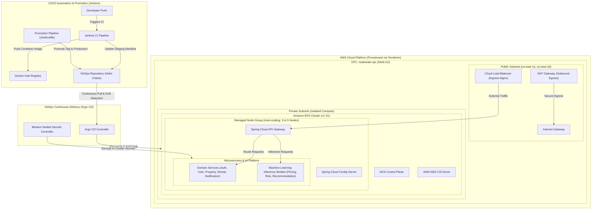
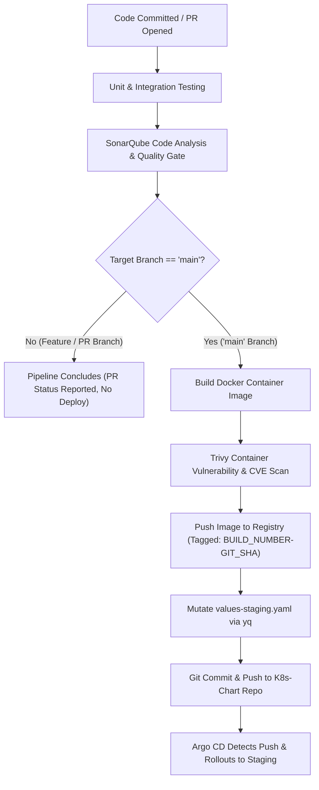

# RealEstate Rental Platform — Cloud-Native Infrastructure & GitOps

Welcome to the **RealEstate Rental Platform** organization. The platform is a microservices-based distributed system built to streamline property leasing, facilitate communication between tenants and landlords, and automate digital rental agreements.

The system is deployed as a **cloud-native platform on Amazon Web Services (AWS)**, fully managed by **Kubernetes (Amazon EKS)**, and operated through automated **Infrastructure as Code (Terraform)**, **Declarative GitOps (Argo CD & Helm)**, and **Enterprise CI/CD Pipelines (Jenkins)**.

---

## 🏛️ End-to-End Cloud & DevOps Architecture

The architecture separates concerns into a clean three-tier operational model: **Cloud Foundation**, **GitOps Delivery**, and **Application Runtime**:

---

## 🏗️ How the Infrastructure Works

### 1. Cloud Foundation: Automated Provisioning with Terraform
The underlying AWS cloud infrastructure is provisioned and managed entirely via Infrastructure as Code:

* **Repository**: [`Terraform-infrastructure`](https://github.com/RealEstate-Rental-JunaidUth-version/Terraform-infrastructure)
* **AWS VPC Networking**:
  * Deployed across multiple availability zones (`us-east-1a`, `us-east-1b`) for high network resilience.
  * Strict subnet isolation: Public subnets host only boundary components (Internet Gateway, NAT Gateway, dynamic Load Balancers), while all compute worker nodes run in isolated private subnets with no direct internet routability.
  * Subnets tagged with `kubernetes.io/role/elb` and `kubernetes.io/role/internal-elb` for automated Kubernetes cloud-controller load balancer discovery.
* **Amazon EKS (Kubernetes v1.31)**:
  * Managed control plane with AWS IAM role integration and public/private endpoint control.
  * Managed Node Group configured for auto-scaling from **3 minimum up to 5 maximum nodes**, cost-engineered for high compute density.
  * AWS EBS CSI Driver pre-installed as an EKS managed addon with IAM policy integration (`AmazonEBSCSIDriverPolicy`) for dynamic persistent storage provisioning.
* **Automated Bootstrap**:
  * Terraform automatically pre-seeds the cluster's Bitnami Sealed Secrets private key into `kube-system`.
  * Installs Argo CD via Helm (`v7.0.0`) and triggers the root Argo CD Application manifests.

---

### 2. Workload Orchestration: Declarative GitOps with Helm & Argo CD
All application deployments, environment variations, and routing rules are declared in Git and continuously reconciled into the cluster:

* **Repository**: [`K8s-Chart`](https://github.com/RealEstate-Rental-JunaidUth-version/K8s-Chart)
* **Unified Meta-Chart Pattern**:
  * Eliminates redundant Kubernetes YAML boilerplate by using parameterized templates (`deployment.yaml`, `service.yaml`, `ingress.yaml`) that iterate dynamically over microservice declarations.
* **Environment Isolation & Parity**:
  * **Staging (`values-staging.yaml`)**: Scaled for rapid testing, dynamic integration tags, and cost-effective compute usage.
  * **Production (`values-prod.yaml`)**: Scaled for high availability, immutable promoted image tags, and hardened configurations.
* **Continuous Delivery with Argo CD**:
  * Two declarative applications ([`argocd-staging-app.yaml`](https://github.com/RealEstate-Rental-JunaidUth-version/K8s-Chart/blob/main/argocd-staging-app.yaml) and [`argocd-app.yaml`](https://github.com/RealEstate-Rental-JunaidUth-version/K8s-Chart/blob/main/argocd-app.yaml)) watch the repository.
  * **Automated Synchronization & Self-Healing**: Enables `prune: true` and `selfHeal: true`. Any manual in-cluster changes (configuration drift) are automatically overridden by Argo CD to match Git.
  * **Zero Cluster Access in CI**: Continuous integration tools never touch the production Kubernetes API; they only commit verified metadata changes to Git.
* **Zero-Trust Secrets Management**:
  * Sensitive credentials are encrypted into `SealedSecret` manifests using asymmetric cryptography (`kubeseal`), allowing safe storage in public/private Git repositories. The in-cluster Sealed Secrets controller decrypts them into native Kubernetes secrets at runtime.

---

### 3. Continuous Integration & DevSecOps Pipelines: Jenkins
Every microservice repository is backed by automated Jenkins pipelines powered by the centralized [`jenkins-shared-library`](https://github.com/RealEstate-Rental-JunaidUth-version/RealEstate-Rental-JunaidUth-version-jenkins-shared-library). The pipeline enforces rigorous code quality, static analysis, container security, and automated GitOps synchronization:

#### Exact Step-by-Step Pipeline Lifecycle:

1. **Code Commit & Webhook Trigger**:
   - A developer pushes code or opens a Pull Request on any microservice repository, triggering the Jenkins pipeline.
2. **Quality & Static Code Analysis (All Branches)**:
   - **Automated Testing**: Runs unit and integration test suites.
   - **SonarQube Quality Gate**: Analyzes source code for code smells, technical debt, test coverage, and security vulnerabilities (SAST). If the code fails the defined quality gate threshold, the build is halted immediately.
3. **Branch Decision Gate (`when { branch 'main' }`)**:
   - **If NOT `main` (Feature Branches & PRs)**:
     - The pipeline completes at this stage. Feedback is published to GitHub (PR check status). **No Docker images are built or pushed**, and no environments are touched.
   - **If `main` (Merged to Main)**:
     - **Container Build**: Compiles and packages the microservice into a lightweight Docker image.
     - **Trivy Vulnerability Scan**: Scans the compiled container image and base OS packages for known CVEs and security flaws before publishing.
     - **Registry Push**: Tags the image with an immutable semantic identifier (`${BUILD_NUMBER}-${GIT_COMMIT.take(7)}`) as well as `latest`, then pushes it to the container registry.
     - **GitOps Staging Trigger**: Clones the [`K8s-Chart`](https://github.com/RealEstate-Rental-JunaidUth-version/K8s-Chart) repository, updates the specific microservice's `tag` in `values-staging.yaml` using `yq`, and commits back to Git with `[skip ci]`.
     - **Automated Rollout**: Argo CD instantly detects the commit in `values-staging.yaml` and deploys the new container into the `staging` namespace.
4. **Promotion to Production**:
   - When staging testing is verified, operators run the [`Jenkinsfile`](https://github.com/RealEstate-Rental-JunaidUth-version/K8s-Chart/blob/main/Jenkinsfile) promotion pipeline, which promotes the verified staging tag to `values-prod.yaml` for production rollout by Argo CD.

---

## 📦 Repositories Directory

### ☁️ Cloud, Infrastructure & GitOps Repositories

| Repository | Description | Key Technologies |
| :--- | :--- | :--- |
| [**`Terraform-infrastructure`**](https://github.com/RealEstate-Rental-JunaidUth-version/Terraform-infrastructure) | Modular IaC for AWS VPC, EKS Cluster, Node Groups & Argo CD Bootstrap | Terraform, AWS EKS, AWS VPC, Helm Provider |
| [**`K8s-Chart`**](https://github.com/RealEstate-Rental-JunaidUth-version/K8s-Chart) | Declarative Helm meta-chart, Argo CD Applications, Staging/Prod values & Sealed Secrets | Helm 3, Argo CD, Kubernetes, Sealed Secrets |
| [**`realestate-rental-jenkins-infrastructure`**](https://github.com/JunaidUthman/realestate-rental-jenkins-infrastructure) | Jenkins infrastructure automation and Configuration-as-Code setup | Docker, Jenkins JCasC, Groovy |
| [**`jenkins-shared-library`**](https://github.com/RealEstate-Rental-JunaidUth-version/RealEstate-Rental-JunaidUth-version-jenkins-shared-library) | Centralized, standardized CI/CD pipeline steps for all microservice repositories | Groovy, Jenkins Pipeline |

---

### 🧩 Microservices & Platform Repositories

| Layer | Repository | Role in Kubernetes Cluster |
| :--- | :--- | :--- |
| **API Gateway** | [**`gateway-estate-rental-service`**](https://github.com/RealEstate-Rental-JunaidUth-version/gateway-estate-rental-service) | Entry point proxy routing external traffic from Load Balancer to services |
| **Central Config** | [**`confi-service`**](https://github.com/RealEstate-Rental-JunaidUth-version/confi-service) | Spring Cloud Config server providing dynamic startup configurations |
| **Config Store** | [**`Config-Repository`**](https://github.com/RealEstate-Rental-JunaidUth-version/Config-Repository) | Git-backed configuration properties consumed by the Config Server |
| **Frontend** | [**`frontend`**](https://github.com/RealEstate-Rental-JunaidUth-version/frontend) | Single-page application web client for tenants and landlords |
| **Authentication** | [**`authorization-service`**](https://github.com/RealEstate-Rental-JunaidUth-version/authorization-service) | Identity verification, JWT token issuance, and authorization policies |
| **User Management** | [**`user-management`**](https://github.com/RealEstate-Rental-JunaidUth-version/user-management) | User profiles, role assignments, and tenant/landlord records |
| **Property Management**| [**`backend-property-management-microservice`**](https://github.com/RealEstate-Rental-JunaidUth-version/backend-property-management-microservice) | Real estate listings, metadata, search index, and property cataloging |
| **Rental Agreement** | [**`Rental-Agreement-Microservice-V2`**](https://github.com/RealEstate-Rental-JunaidUth-version/Rental-Agreement-Microservice-V2) | Digital lease contract lifecycle, agreement terms, and signing workflows |
| **Notifications** | [**`notification-estate-rental-service`**](https://github.com/RealEstate-Rental-JunaidUth-version/notification-estate-rental-service) | Alerting, email triggers, and operational event messaging |

---

### 🧠 Machine Learning & Predictive AI Engines

| Repository | Purpose in Kubernetes Ecosystem |
| :--- | :--- |
| [**`ML-PriceSuggestionModel`**](https://github.com/RealEstate-Rental-JunaidUth-version/ML-PriceSuggestionModel) | AI valuation engine delivering dynamic rental pricing suggestions |
| [**`Predictive-Map-Ai-Model`**](https://github.com/RealEstate-Rental-JunaidUth-version/Predictive-Map-Ai-Model) | Geospatial machine learning model forecasting neighborhood price trends |
| [**`Property-Recommendation-Engine`**](https://github.com/RealEstate-Rental-JunaidUth-version/Property-Recommendation-Engine-K-MEANS-Cosine-Similarity) | K-Means & Cosine-Similarity engine personalizing property recommendations |
| [**`Tenant-Risk-Scoring`**](https://github.com/RealEstate-Rental-JunaidUth-version/Tenant-Risk-Scoring-RandomForestClassifier) | Random Forest classifier assessing tenant risk scores for landlord decisions |

---

## 🔒 Key DevOps & Security Principles

1. **Immutable Infrastructure**: Cloud topology is declared in Terraform; manual AWS console alterations are avoided.
2. **Git as the Single Source of Truth**: Application state changes occur exclusively through Git pull requests.
3. **Least Privilege & Zero-Trust**:
   - Worker nodes have zero public IP addresses.
   - Kubernetes secrets are never committed in plaintext.
   - CI runners have no direct administrative permissions to the Kubernetes API.
4. **Resilient Auto-scaling**: EKS node groups scale from 3 to 5 nodes to handle traffic spikes smoothly while maintaining cost efficiency.
